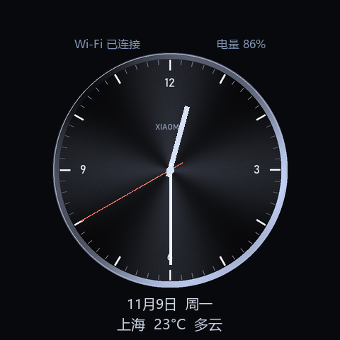
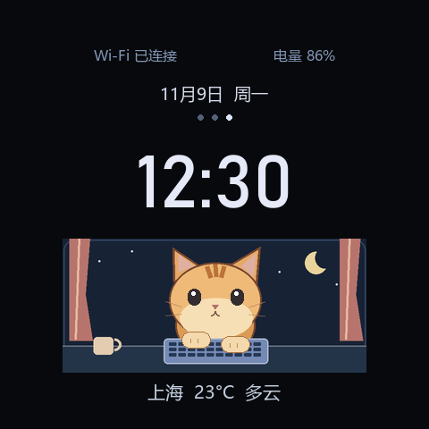

# 时钟 0.2.0

保留原来的大号HH:MM翻页时钟，新增金属指针、敲键盘猫咪数字表盘。屏幕中部左右滑动循环切换，至少48像素的水平移动且以水平为主才生效；上下操作留给系统。选择保存在clock-face.json，重开应用后恢复。




预览图使用固定示意时间/天气；设备显示北京时间、当前日期星期、Wi-Fi、电量及真实天气。原翻页款继续只显示时分，不显示秒数；新数字款也只显示时分，指针款有红色秒针，1Hz更新。

猫咪按用户第二张参考图的橘色条纹猫、浅色脸颊、夜窗帘、月亮、杯子及键盘重新用代码绘制。左右爪通过原生小区域交替升降，250ms一帧，并有约5秒一次的眨眼；切离猫咪款、后台或息屏时不更新猫咪。没有整屏动画视频、没有每帧写入Flash。

天气优先读取天气App已保存城市及缓存；默认上海。时钟自己的异步HTTPS请求只获取当前温度及天气代码，约10分钟刷新，30分钟以上标为过期缓存；离线保留缓存或显示待更新。不改写天气App的设置和缓存。电池读取系统已有30秒缓存，区分百分比/充电/USB供电/未知。

## 构建

```powershell
python brookesia-apps/flip-clock/tools/generate_assets.py
python codex-quota-monitor/tools/package_clock_faces.py
python codex-quota-monitor/tools/deploy_clock_faces.py --port COM5
```

需要Pillow和Windows字体Bahnschrift、微软雅黑；源码不包含字体文件。面板背景为原生RGB565/RLE，指针用原生Line，不为每个角度生成图片；猫咪眼睛和前爪为独立原生控件。新资源在SD，系统固件继续s3.58；旧时钟目录在SD私有resource-backups备份，其他应用/音量不变。更新时需没有活动播放/对话并保持未锁屏。

## 验证

原翻页的午夜/分钟变化、前后台、时钟跳变回归通过；新增覆盖三款循环/选择记忆、垂直手势忽略、指针坐标范围、猫爪生命周期、动画不写Flash、HTTP请求匹配/缓存及供电状态。

实机0.2.0安装、十四应用及55%音量保留，唤醒后分别打开两款新表盘，原生指针绑定和猫爪更新均未报错；上海真实天气已返回约11.9°C/阴。设备现停猫咪款。实屏左右滑动、动画观感及文字布局仍待用户确认，未标为物理手势验证完成。
