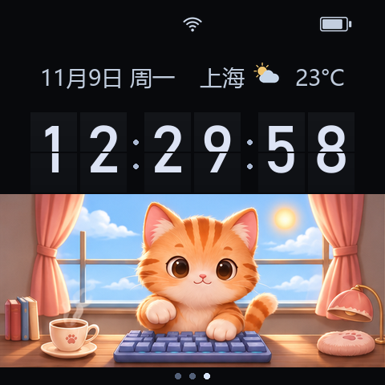
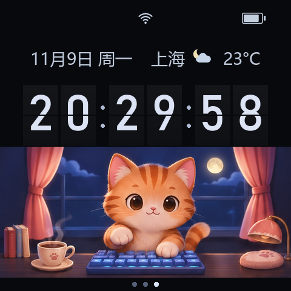

# 时钟 0.2.5

猫咪数字表盘采用已确认的图标排版：顶部居中Wi-Fi、右侧电池，日期在左、
城市/天气图标/温度在右；82px时分秒分体翻页，28px日期/温度/默认城市文字，全宽猫咪场景，
底部分页圆点。保留原HH:MM大字翻页和金属指针；中部左右滑动循环三款并记忆。




预览图状态均为示意。设备显示北京时间、真实城市天气与电池缓存数据。
Wi-Fi区分连接/断开；电池以10%填充档位表示，另有充电闪电、USB插头及未知横线。
天气覆盖晴、昼夜多云、阴、雨、雪、雾、雷雨及未知，晴天/多云的太阳与月亮
随当地日出日落切换。较长城市名动态调整宽度及字号，避免与日期、天气图标互相覆盖。

## 翻页与绘制

0.2.2部署后用户反馈秒翻页不流畅；0.2.3改为原生补间，随后收到进位时残留半页反馈。
0.2.4保留原生补间，并用独立hidden状态显式收起所有翻页遮片，避免依赖动画
修改过的透明度或几何绑定缓存。重点覆盖09→10、59→00、跨分钟及跨午夜。
每个变化数字只提交一次GUI批处理，出页180ms、入页180ms；五条原生动画轨道
处理上半页的位移/高度/透明度和下半页的高度/透明度。现有时钟节拍收尾并释放
动画订阅，不为每一秒创建新的JS逐帧定时器。暂停、换表盘、息屏和时间跳变会
收拢数字；原来的四位大字翻页仍沿用原实现。

猫咪的窗景/桌面用480×216固定底图，只有216×216区域按180ms更新，重绘面积比
0.2.2减少55%。八帧双爪敲击，每四循环眨眼；不同时手动预载全部帧。
素材由内置imagegen生成，源图、提示词、哈希和裁切参数在assets/。
后台/息屏停止画面更新；不做连续逐帧或逐秒Flash写入。诊断只在表盘选择、
首轮动画完成及昼夜改变时落盘。`native_flips`是调度计数，不是显示帧率。

天气优先只读天气App城市/缓存，默认上海；时钟每约10分钟直接HTTPS获取
温度、天气代码、is_day和三天sunrise/sunset/daylight_duration。按城市时区选择
当天日出日落，日出进入白天、日落进入夜晚，跨日重新选日期；极昼/极夜使用
日照时长。缺少当天太阳数据时暂用is_day或初始白天，并在诊断标明回退来源。
离线保留缓存；不改天气App设置。电池复用系统30秒缓存。

## 构建、部署及恢复

```powershell
python brookesia-apps/flip-clock/tools/generate_assets.py
python codex-quota-monitor/tools/package_clock_faces.py
python codex-quota-monitor/tools/deploy_clock_widgets.py --port COM5
# 用ESP-IDF Python运行capture_brookesia_boot.py --reset，或手动重启设备
python codex-quota-monitor/tools/verify_clock_cat.py --port COM5
```

需要Pillow、Node.js、Windows Bahnschrift/微软雅黑；不分发字体文件。
固件继续s3.58，附加应用与资源在SD，不要求刷新固件。

0.2.2约1.75MB整包安装曾触发SystemApp临时分配std::bad_alloc，旧版完好。
新部署工具在电脑解包BPK、逐文件上传SD临时目录，再用设备端流式SHA256核对
完整应用树。旧目录保持完整，验证后通过目录重命名切换；原目录保留在
SD私有resource-backups，切换异常时尝试回退。重启刷新应用注册后，核对版本、
其他应用与音量。工具拒绝与旧发布包不匹配的现场修改；不会擅自覆盖未知编辑。
这绕开了本应用大包安装的临时内存峰值，不等于修复所有系统内存问题。

大于32KiB的JSON使用设备端流式整树哈希校验，避免依赖长USB字符串回显。
运行记录和恢复目录不入Git；历史BPK保留供旧树比对及恢复。

## 验证

单元回归覆盖原翻页午夜/分钟变化、暂停恢复、三款切换记忆、指针坐标；
六位跨午夜/跨秒、仅变化数字原生调度、无逐帧JS界面调用、连续动画不写Flash、
息屏/时间跳变、Wi-Fi/电池各状态、全部天气图标及太阳数据边界。

0.2.4进位不再卡半页已由用户实屏确认，两分钟连续运行未发生应用错误；
0.2.5放大日期与天气文字，最终安装检查结果见仓库TASK_STATUS.md；0.2.2已有14应用、
原60%音量保留，以及实际上海太阳数据和临时昼夜资源检查通过记录。
短时内存稳定检查不能替代长期、多音频/蓝牙/离线识别同时工作的压力测试。

2026-11-09最终0.2.5已部署：108文件整树SHA256、76项动画/翻页/图标资源大小、
真实上海太阳数据、临时昼夜图标及三款关闭重开全部通过；临时天气缓存已恢复。
14应用、原60%音量保留。最终PSRAM余量约1.63MiB、内部余量约63.6KiB，
DMA最大块54KiB（本次重启后的样本，不作长期保证）。日期/天气大字配置已上板，
尚未单独收集用户对28号字大小的反馈；进位修复已在0.2.4由用户确认。
