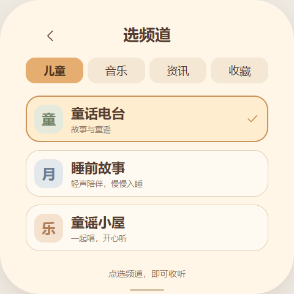
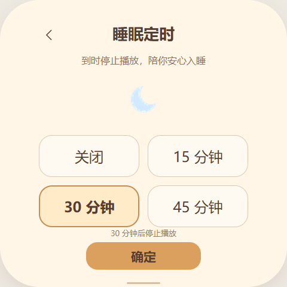

# 小马电台：界面设计稿

当前仅为界面与交互预览，尚未接入音频流、安装到设备或占用设备音频服务。频道名称、连接状态和音量均为示例，不代表已经确认可用的直播源。网页不发起任何网络请求，也不实际播放声音。

打开 [交互预览](design/preview.html) 可体验播放/暂停、上下频道、收藏与分类、频道选择、睡眠定时。设计画布480×480，采用奶油手绘风、大号文字和触摸目标；首页聚焦当前频道，底部仅留“选频道”和“定时”。音量复用设备两侧实体键，显示当前值，中间电源键保持系统行为。

| 播放页 | 频道页 | 定时页 |
| --- | --- | --- |
|  |  |  |

- 播放页：频道名、类别/简介、播放状态、收藏、上一频道/播放暂停/下一频道、选频道和定时入口。
- 频道页：儿童/音乐/资讯/收藏分类，一屏三项，大行高。点击直接切换并回到播放页。首版建议以家长确认的儿童内容为主，实际频道需验证合法公开流与稳定性后加入。
- 定时页：关闭、15、30、45分钟；确认后返回播放页并显示时长。现稿仅演示选择，不运行真实停止倒计时。

后续实现需复用系统音频所有权、实体音量、勿扰和儿童模式限制，与听书/语音助手互斥；处理连接、缓冲、播放、暂停、断网重连与音源不可用状态。电台只使用Wi-Fi网络音频流，不提供FM/AM调谐功能。界面插画应作为小幅静态资源预载，动态反馈仅用少量局部变化，避免全屏频繁刷新。

本次设计阶段只保存原型及预览图片，尚未更改固件、应用版本和设备内容。

2026-11-02验证：Chrome独立预览成功渲染三张480×480画面；播放/暂停、上下频道、收藏列表、选台返回、30分钟定时选择与显示检查通过。360px浏览器视口无横向溢出，月牙引用资源正常，无脚本异常。这是桌面交互原型检查，不代表设备音频或实机显示已完成。
