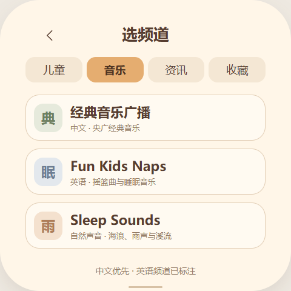

# 小马电台 0.1.2

设备端Wi-Fi电台应用，配套固件 **0.8.3-s3.42及以上**。原创“小马收音机”图标采用奶油、暖橙、棕色Q版配色，带圆角正方形底框、四角透明；92×92 RGB565A8/RLE图标和166×166应用插画预载复用。


## 使用

- 首次默认苏州儿童广播，之后记住上次频道和收藏；打开应用不自动出声，点击播放后连接真实音源。
- 儿童/音乐/资讯/收藏四类，中文优先，英语明确标注；每页最多三项，收藏较多可翻页。真实台名、节目说明及官方来源见 [STATIONS.md](STATIONS.md)。
- 上一台/下一台、播放/暂停、锁屏、选频道、定时；左右实体键调整系统音量，中间电源键保留原行为。界面每秒同步音量与勿扰状态。
- 播放后可设置关闭、15/30/45分钟定时；原生单调时钟独立计时，到时停播并关闭网络。定时不跨重启恢复，不执行听书专用的故事淡出和晚安流程。
- 暂停保留有限缓冲，继续可能稍落后直播。断线自动重试，连续失败后显示切台/重试提示；退出应用释放网络、解码和喇叭资源。
- 复用系统音频互斥、定时勿扰及实体音量。沿用儿童模式白名单：新增网络电台不自动向儿童开放，首版在普通模式使用。

安装在系统默认应用存储位置，当前设备优先使用SD卡。联网与解码在ESP32完成，不依赖电脑代理、电脑中转或下载完整节目。

当前为试验版：苏州台停顿暂缓排查，Naps在本次热点测试中有短顿；连续播放后的音量接口复测出现超时，后续控制回归未完成，仍需排查。停止播放后已恢复原音量和设置，详见[实机验证](VERIFICATION.md)。

三页内容按用户反馈整体上移16像素；底部“选频道”“定时”按钮底边从482调整到466，为屏幕底边和系统手势留出空间。

点击播放页右侧“锁屏”会熄屏并屏蔽触摸，电台继续播放，原睡眠定时继续计时；双击实体音量加键解锁返回。沿用系统既有锁屏行为。原有收藏数据及频道页“收藏”分类保留，播放页不再提供添加/取消收藏按钮。

## 原生播放器

`platform/super_s3_216/main/modules/radio/`提供Radio服务。HTTPS验证系统根证书，不关闭证书检查；应用只能选择编译目录中的台号，不能提交任意URL。

网络接收任务 → 128KiB PSRAM压缩队列 → dr_mp3逐帧推送API（复用听书解码器）/ESP Audio Simple Decoder（AAC/HE-AAC、MPEG-TS）→ 16kHz双声道PCM → 64KiB缓冲与独立输出任务。起播先预取32–64KiB压缩数据（TS 32、AAC 48、MP3 64）；保留尚未消耗的输入，网络、解码和GUI分开。MP3使用逐帧接口，避免文件式接口一次等待64KiB直播数据。队列固定上限，不将直播全部放进内存或SD卡。

HLS按媒体序号去重，从接近直播端的两个片段开始，支持有限层数主列表、相对/绝对URI和序号复位。不支持加密、fMP4或字节范围HLS。央广目录源为未加密MPEG-TS。统计接口提供接收/输出字节、重连、断粮、输出间隔、栈和堆余量。

TCP接收窗口与邮箱保留原配置5760字节/10项，Wi-Fi/lwIP优先从PSRAM分配。试验中的大窗口未解决手机热点上的连续接收问题，已回退进行对照。播放期间暂时关闭Wi-Fi modem省电，停止或失败退出后恢复之前的省电方式。

MP3推送解码保留至少4KiB输入余量后再请求下一块，避免把HTTP分片尾部的半帧误当无效数据丢弃。Wi-Fi静态接收缓冲从4个增加到8个，与8帧聚合接收窗口匹配。接收返回值、累计/最大读取耗时、解码耗时、信号强度和内部最大空闲块可由Radio.GetState读取。目录入口均使用HTTPS并校验证书。

直播体采用1KiB小块读取，连接和证书校验仍保留4秒超时；响应头完成后将HTTP轮询及底层套接字的接收等待均设为250ms。只调整HTTP超时不会改变TLS连接建立时设置的socket超时，原先因此仍可能阻塞约4秒。短超时保留TLS/HTTP解析状态并继续读取，连续12秒无数据才重连。

## 构建与安装

先按主仓库说明准备ESP-IDF、Python与Node依赖。矢量源和工具均在仓库内，sharp用于SVG栅格化，Pillow用于原生RGB565A8转换。

```powershell
npm ci --prefix brookesia-apps/radio
python -m pip install -r brookesia-apps/radio/tools/requirements-assets.txt
python tools/generate_radio_catalog.py
node brookesia-apps/radio/tools/build_art.cjs
python brookesia-apps/radio/tools/build_layout.py
python codex-quota-monitor/tools/package_radio.py
```

`SHARP_MODULE`可指向本机sharp模块。`stations.json`生成固件白名单和设备精简目录；更换URL须重新编译固件，修改显示交互可只更新BPK。发布包：[电台0.1.2](../../packages/apps/local.radio.debug.0.1.2.bpk)、[s3.42应用分区](../../packages/firmware/brookesia-0.8.3-s3.42-app-only.zip)。

已有s3.41设备须先做本地完整备份，再用主仓库更新器只写s3.42应用分区，保留分区表、NVS、LittleFS和SD。随后运行：

```powershell
python codex-quota-monitor/tools/deploy_radio.py --port COM5
python codex-quota-monitor/tools/verify_radio.py --port COM5
# 单台延长抽样（仍检查暂停、定时、断网及互斥）
python codex-quota-monitor/tools/verify_radio.py --port COM5 --station suzhou-qtfm --sample-seconds 120
```

部署器核对固件及应用/故事保留，有旧电台时先备份其目录。验证器临时静音逐台检查，测试暂停、音量寄存器、勿扰、十秒诊断定时、重复打开及Wi-Fi断开/重连，最后恢复音量和自动深睡选择。请在听书、对话和睡眠定时结束后运行。

## 设计稿与验证记录

[浏览器交互稿](design/preview.html)为早期静音预览，不实际播放；连接状态、播放和定时为模拟。设备界面由`src/res/screens/main.json`定义，JS负责交互，Radio服务负责真实播放。

| 播放设计 | 儿童分类设计 | 音乐分类设计 |
| --- | --- | --- |
|  |  |  |

2026-11-03：其余七台每台约两分钟测试中，Junior、Story Quest、经典音乐、Sleep Sounds、中国之声、经济之声零断粮；Naps记录到3次断粮、最长输出间隔约0.66秒。苏州台此前仍有停顿，按用户要求暂缓排查。没有据此宣称所有设备端因素均已排除；详见 [实机验证](VERIFICATION.md)。用户已确认圆角底框与上移后的布局正常。

0.1.1：自带音量移至页头；配合s3.44，桌面全局音量/电量在App内隐藏。音频链路保持本次界面调整前的实现。
