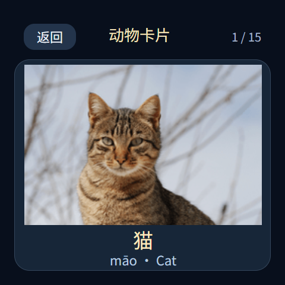

# 轻学习 0.1.2 · 内容包 1.3.0

适用于 ESP32-S3-Touch-AMOLED-2.16，需 0.8.3-s3.27 固件及 SD 卡。安装后离线使用，无需电脑或云端模型。

| 活动 | 启蒙包 | 操作 |
| --- | --- | --- |
| 动物卡片 | 15张：猫、狗、牛、马、兔子、鸭、猪、羊、鸡、鸟、鱼、熊、狮子、老虎、猴子 | 左右拖动大照片循环切换，显示中文、拼音及英文；真人中文录音之后停顿450ms，再播放真人英文录音，轻点照片重播，无独立“听名字”按钮 |
| 口算 | 12 道加减法 | 点击三个答案之一，即时提示对错；上一题、下一题、随机一题 |
| 英语跟读 | 8 个词句 | 听示范、录音、回放；默认录 5 秒，可提前结束，不做识别或打分 |

没有动物叫声猜谜。录音仅保存在设备内存中，切换题目、内容包、退出或进入后台即清除，不上传、不保存到 SD。实体音量键、静音及儿童模式音量上限继续生效。进入应用会停止听书并断开在线助手，避免争用麦克风和喇叭。

已有儿童模式设置保持原样；其白名单默认不会自动开放新应用。家长在“可用应用”中启用“轻学习”后才向儿童开放，休息时间仍禁止使用。

## 安装

先运行 `stop.ps1` 释放 USB 接口，并使用 `tools/backup_current_firmware.py` 创建及校验设备备份。只更新应用分区，保留 NVS、原应用、故事及 SD 数据：

```powershell
# 以下在 codex-quota-monitor 目录执行；COM3 替换为实际设备端口。
# 先解压 packages/firmware/brookesia-0.8.3-s3.27-app-only.zip 到独立目录。
.venv\Scripts\python.exe tools/update_brookesia_app_only.py --port COM3 --build <解压目录> --backup <已校验备份目录>
.venv\Scripts\python.exe tools/deploy_learning.py --port COM3
```

安装器校验内容包 CRC/SHA256，向 SD 写入音频、照片与 JSON，合并内容包目录，保留其他包；覆盖同名包前备份到 `/sdcard/resource-backups/learning-install-时间戳`。文件先上传到独立目录并校验，再复制覆盖已备份的资源，兼容 FAT SD 卡无法直接重命名覆盖的情况。完整安装同时更新儿童模式 0.1.1，注册拼音补充字体并备份旧字体索引及儿童模式应用。最后重新启动设备以加载字体和桌面图标，再恢复 `start.ps1`。

本次1.3.0仅更新内容，固件仍为s3.27、应用仍为0.1.2。已安装轻学习的设备直接运行 `tools/deploy_learning.py --port COM3 --content-only`，重新打开应用即可，无需刷写固件。

1.3.0已通过设备自动检查：15张照片全部加载、左右切换及首尾循环成功，口算和英语页面正常；15段中英文名称音频全部完整播放，无重启，音频任务最小剩余栈5892字节。检查后恢复正式应用、原音量100及10本故事。2026-10-28用户实测确认新增卡片“照片与中英文读音正常”。原6张照片及真人录音、8段英语示范的文件保持一致。

## 添加内容包

内容与应用分离，目录如下：

```text
/sdcard/learning/index.json
/sdcard/learning/packs/starter/pack.json
/sdcard/learning/packs/starter/images/cat.png
/sdcard/learning/packs/starter/audio/card-cat.wav
```

`index.json`：

```json
{"schema":1,"packs":[{"id":"starter","title":"启蒙包"}]}
```

一个最小的 `pack.json`：

```json
{
  "schema": 1,
  "id": "starter",
  "title": "启蒙包",
  "cards": [{"name":"猫","pinyin":"māo","english":"Cat","image":"images/cat.png","audio":"audio/card-cat.wav"}],
  "arithmetic": [{"a":1,"b":2,"operator":"+","choices":[2,3,4],"answer":3}],
  "english": [{"text":"Hello","meaning":"你好","audio":"audio/en-hello.wav","record_seconds":5}]
}
```

三个分类必须存在，可以是空数组，但总内容不能全空。每类最多 128 条，最多 16 个包；包 ID 为小写字母、数字、下划线或短横线，最长 32 字符，首字符为字母或数字。图片用不大于 256×256 的 PNG，建议 256×192，设备以400×270区域等比放大显示；音频为 16kHz、单声道、16 位 PCM WAV，最长 20 秒。录音配置为 1–8 秒。口算支持 0–100 的两个整数加减、非负结果及三个不同的非负答案。

路径相对本包，不能含 `..`、绝对路径或反斜杠。名称、拼音和英文长度限制见应用 `validatePack`。当前字库覆盖启蒙包和常用汉字；增加生僻字时需先检查字库覆盖，不能仅添加 JSON。

自定义 ZIP 包根目录包含 `index.json`、`packs/<id>/pack.json` 和媒体，并包含 `manifest.json`：

```json
{"schema":1,"version":"1.0.0","files":{"index.json":{"bytes":123,"sha256":"对应文件的完整SHA256"}}}
```

`files` 列出所有待安装的 JSON、WAV、PNG（不包括 manifest 本身），填写实际字节数及 SHA256。每个文件不超过 512KiB，最多 1024 个文件。示例构建器 `tools/build_learning_packages.py` 展示完整格式；压缩包中的插画 SVG 原稿不需要安装。添加包无需修改固件或应用：

```powershell
.venv\Scripts\python.exe tools/deploy_learning.py --port COM3 --content <新包.zip> --content-only
```

重新打开轻学习，在首页选择内容包即可。

## 来源与重建

- 动物使用真实照片，来源、作者、许可及缩放说明见 [照片署名](../brookesia-apps/light-learning/packs/PHOTO-CREDITS.md)，同样的信息通过 `photo-sources.json` 随1.3.0内容包安装到SD。可用 `tools/build_card_images.cjs` 配合 sharp 从校验后的原图重建PNG；旧SVG插画原稿仅留作历史参考，不参与新版内容包。书本图标仍为本项目绘制。
- 15张动物卡片改用已有真人中文及美式英文词条录音，每张先中文再英文，不使用语音合成、克隆或逐字拼接。来源、说话人及许可见 [录音署名](../brookesia-apps/light-learning/packs/AUDIO-CREDITS.md)，`audio-sources.json`随1.3.0内容包安装。`tools/build_recordings.py`校验原录音哈希，再进行格式转换、音量调整和中英顺序编排；不改变语速或音高。
- 英语跟读的8段独立示范保留原有 Windows Zira 合成，`tools/build_speech.ps1`只重建这些示范，不会覆盖动物卡片真人录音。用户跟读仍仅在设备内存中录音回放。
- 拼音补充字体来源为 Noto Sans SC 2.04，按 OFL 1.1 重新命名为 LearningSupplement 并子集化；来源及原始哈希见 `packs/font-source.json`，许可见 `packs/OFL.txt`。
- `tests/main.test.cjs` 验证三类活动、滑动、媒体路径、内容包扩展及录音清除；仓库 `tests/learning_media_static.cpp` 验证本地音频边界及儿童授权。固件构建后仍需实机验证滑动手感、名称读音和麦克风回放。

`tools/verify_learning.py --port COM3` 检查已安装版本、字体、完整音频播放、录音清除和原音量恢复；添加 `--record-test` 会明确执行一次1秒的内存录音及静音回放，随后清除。报告只保存指标到私有 `runtime`，不会导出音频。可用 `--before <私有安装前快照>` 对比原故事、书签、家长设置及助手模式；现有儿童模式必须已允许轻学习且不在休息时间。

`tools/verify_learning_pages.py --port COM3` 会暂时安装自动切页的检查版本，静音依次显示内容包的全部动物图片，验证左右方向和首尾循环，再显示口算和英语，检查无重启，最后恢复正式应用和音量。此检查覆盖真实设备图片加载，不能由首页启动或单独播放音频检查替代。运行前先停止额度同步，完成后恢复；勿与手动操作同时进行。

预览由实际界面资源及脚本渲染，属于模拟画面，不是设备截图：


