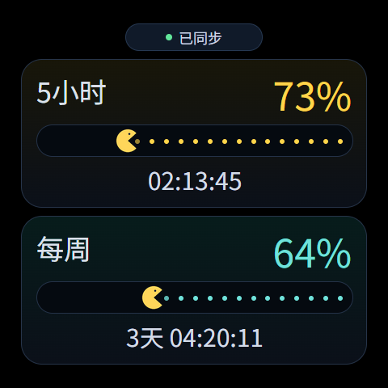

# 额度显示 App

`local.codex.quota` 0.2.3，使用现有Storage服务，可独立安装，无需更新s3.25固件。
源码位于 `brookesia-apps/codex-quota`，桌面中文名称为“额度显示”。

按参考图使用黑色背景与两张圆角渐变卡片：“5小时”和“每周”标题34号，
右侧真实剩余百分比48号，下方重置倒计时30号。短周期为金色、每周为青色。
顶部状态胶囊显示已同步、已过期、需登录或采集失败，并以绿/黄/红点区分。
倒计时不重复显示“重置”，超过一天时保留天数。



该预览由应用布局及脚本生成，用于核对比例，不是设备截图，也不是当前账户数据。
设备仍从 `/littlefs/quota.json` 读取真实额度，示例数值不会上传至设备。
每颗完整豆子代表5%剩余额度，部分豆子以透明度显示不足5%的部分；
吃豆人位置随真实已用比例变化，嘴巴每240ms开合，动画不消耗或改变额度。
过期数据停止动画，后台停止动画定时器；同一QuickJS VM可重复打开。

Q版额度图标已随应用打包，后续重装不再依赖一次性的桌面主题覆盖。
更新图标或名称后需要重启设备以清除桌面缓存。

构建与验证（仓库根目录）：

```powershell
codex-quota-monitor/.venv/Scripts/python.exe codex-quota-monitor/tools/build_quota_bpk.py
node brookesia-apps/codex-quota/tests/main.test.cjs
```

构建直接打包JSON、JS和PNG资源，不需要Node打包工具；PNG由现有固件解码。
发布包为 `packages/apps/local.codex.quota.debug.0.2.3.bpk`，SHA256见 `packages/SHA256.json`。
安装前暂停占用同一USB接口的额度采集器，再执行：

```powershell
codex-quota-monitor/.venv/Scripts/python.exe codex-quota-monitor/tools/deploy_quota_cards.py --port COM3
```

安装工具在SD卡保留旧应用，保留额度文件和音量，自动处理已有的异步目录清理超时。
实际端口按电脑调整。完成并关闭USB验证连接后，通过 `codex-quota-monitor/start.ps1`
恢复电脑端每60秒采集、每15秒推送；电脑端登录状态及网络需正常。
私有设备验证结果保存在 `codex-quota-monitor/runtime`，不纳入Git。

2026-10-27实机验证：安装并重启后中文名称、图标索引及图标文件尺寸正确；
真实额度、吃豆人位置和8帧以上动画一致，连续重新打开两次均无应用错误；
原有10篇故事和90%音量保留。
