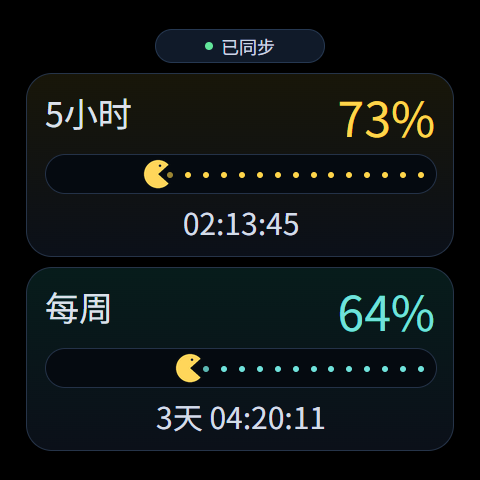

# 额度显示 App

`local.codex.quota` 0.2.4，使用现有Storage服务，可独立安装；当前系统固件仍为s3.63，无需重刷。
源码位于 `brookesia-apps/codex-quota`，桌面中文名称为“额度显示”。

按参考图使用黑色背景与两张圆角渐变卡片：“5小时”和“每周”标题34号，
右侧真实剩余百分比48号，下方重置倒计时30号。短周期为金色、每周为青色。
顶部状态胶囊显示等待同步、已同步、已过期或需登录，并以绿/黄/红点区分。
倒计时不重复显示“重置”，超过一天时保留天数。



该预览由应用布局及脚本生成，用于核对比例，不是设备截图，也不是当前账户数据。
设备仍从 `/littlefs/quota.json` 读取真实额度，示例数值不会上传至设备。
每颗完整豆子代表5%剩余额度，部分豆子以透明度显示不足5%的部分；
吃豆人位置随真实已用比例变化，嘴巴每240ms开合，动画不消耗或改变额度。
过期数据停止动画，后台停止动画定时器；同一QuickJS VM可重复打开。

Q版额度图标已随应用打包，后续重装不再依赖一次性的桌面主题覆盖。
更新图标或名称后需要重启设备以清除桌面缓存。

构建与验证（仓库根目录）：

```powershell
codex-quota-monitor/.venv/Scripts/python.exe codex-quota-monitor/tools/build_quota_bpk.py
node brookesia-apps/codex-quota/tests/main.test.cjs
```

构建直接打包JSON、JS和PNG资源，不需要Node打包工具；PNG由现有固件解码。
发布包为 `packages/apps/local.codex.quota.debug.0.2.4.bpk`，SHA256见 `packages/SHA256.json`。
安装前暂停占用同一USB接口的额度采集器，再执行：

```powershell
codex-quota-monitor/.venv/Scripts/python.exe codex-quota-monitor/tools/deploy_quota_cards.py --port COM3
```

已有SD应用建议使用 `tools/deploy_quota_requests.py --port COM5`：逐文件暂存并哈希验证JS/manifest/root三文件，切换前备份整个旧目录，保留当前安装的主题图标、额度文件和音量。完成后重启一次以登记版本。无需覆盖固件、PIN或系统偏好。
私有设备验证结果保存在 `codex-quota-monitor/runtime`，不纳入Git。

## 设备请求与Codex联动

- 额度页启动/恢复时立即发出一个带唯一`request_id`的请求，前台每60秒再次请求；离开额度页标记inactive并停止请求。请求文件是`/littlefs/quota-request.json`，不含账号或凭据。
- 手动运行一次`launch-codex.ps1 -InstallShortcut`，会创建桌面**Codex (device sync)**快捷方式。之后从这个入口打开Codex即会启动轻量USB监听，无需再手动启动同步程序；退出Codex桌面后自动结束。不创建开机启动项或计划任务，原来的Codex启动入口不受修改。
- 监听约每2秒检查设备请求，只有新请求且Codex桌面正在运行才调用`account/rateLimits/read`。查询使用单独的短时`codex app-server --stdio`辅助进程，读取完成即关闭，不发起模型对话。
- 不再由电脑定时查询或周期发送旧缓存。`poll_seconds`仅保留给旧版独立固件，当前Brookesia模式不使用它。显示有效性不依赖电脑写文件的心跳。
- 设备发出请求后15秒内没有对应有效结果，显示**已过期**并暂停吃豆人动画，保留最后一次真实数字。旧请求、其他请求的响应以及单独刷新的`bridge_at`都不能恢复有效状态；匹配的新成功结果到达后才恢复。明确的未登录回应显示**需登录**，其他查询失败显示已过期。
- Windows进程检测区分真正的Codex桌面与后台app-server，辅助进程不会让监听误认为桌面仍在运行。当前启动器支持本机使用的`OpenAI.Codex` Store包，并按包家族名激活，以适应版本升级。

2026-11-10验证：JS覆盖60秒请求、15秒无回应过期、旧响应不能续期、暂停/恢复及原动画；电脑39项测试通过，包括缺请求/无Codex不查询、无设备请求不轮询、查询后辅助进程关闭及退出检测。实机无监听显示已过期，联动启动后匹配响应恢复已同步，第二次请求间隔约60.1秒。联动启动已实际验证；退出条件使用模拟进程状态测试，未关闭当前正在进行开发的Codex窗口。

2026-10-27实机验证：安装并重启后中文名称、图标索引及图标文件尺寸正确；
真实额度、吃豆人位置和8帧以上动画一致，连续重新打开两次均无应用错误；
原有10篇故事和90%音量保留。
