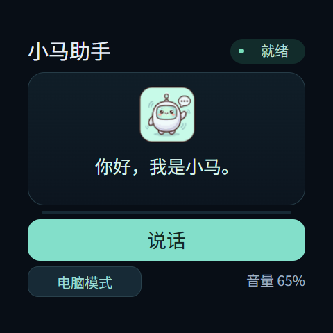
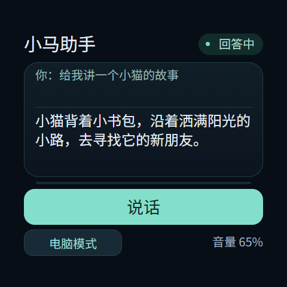

# 小马助手 0.2.2

设备应用名称为“小马助手”，应用ID继续使用 `local.voiceassistant`。
当前电脑模式依赖s3.25原生服务，Qwen3-ASR → DS云端 → Qwen3-TTS的配置见
[电脑语音桥接](../pc-voice-bridge/README.md)。也可切换既有小智服务。

## 简洁界面与使用

顶部显示名称及连接/聆听/上传/回答状态；中间卡片在待机时显示Q版头像与问候，
对话时显示识别文字和回答摘要。只保留“说话/发送”主按钮和电脑/小智模式切换。
已移除连接/断开、停止、录音测试、音量加减按钮及“点击说话”等常驻说明。
音量由实体键调节，界面显示当前值；勿扰时显示保存音量与静音标记。

1. 打开应用自动建立会话，不自动采集麦克风。模式切换、从后台恢复时重新连接。
2. 点击“说话”，等待“准备中”变为“发送”再开口；再次点击“发送”提交，最长30秒。
3. 回答播放时可点击同一个“说话”按钮开始下一轮；离开应用释放连接和音频。
4. 网络失败后主按钮提供连接入口；小智首次绑定时卡片显示激活码及xiaozhi.me。
5. 真实错误或小智会话栈保护信息仍显示；需要重建会话时可离开后重新打开。





预览根据应用JSON布局及实际JS脚本生成，使用模拟状态、文字与音量，不是设备截图。
本次提供源文件和 `packages/apps/local.voiceassistant.debug.0.2.2.bpk`；
尚未安装到设备、未采集实际录音。现有配对仍保留在设备NVS和电脑私有运行目录。

```powershell
node brookesia-apps/voice-assistant/tests/main.test.cjs
```

检查覆盖GUI路径与绑定、已移除动作无副作用、激活保护、手动发送、播放中下一轮、
模式切换重连、实体音量与勿扰、后台释放、定时器复用及同一VM重新打开。
安装时可使用原有 `tools/deploy_pc_voice.py`，其版本从 `versions.json` 选择。
以下为小智原生服务结构及历史验证记录，历史按键说明以本节当前界面为准。

## 小智原生服务与历史实现

第一版没有唤醒词和全双工回声消除；手动录音最长 30 秒。无需 SD 卡或常开电脑。
编解码任务栈在 PSRAM 分配 48KiB，联网/录音控制任务使用 16KiB 内部 RAM。每帧采集和编码前后检查编解码任务的历史峰值用量。达到 40KiB 时结束录音，提交已上传的语音，继续接收并播放回答。
这是任务栈限制，不是录音文件大小限制。触发保护后需断开再连接，重建任务后才能继续录音；没有有效语音帧时不会提交空请求。
检查发生在帧边界，不能在单次底层库函数内部抢占；额外 8KiB 留给退出、提交和清理。
对话期间暂时独占音频；打开助手前会停止听书，听书已有书签保留，之后需手动继续播放。

## 代码结构

- `brookesia-apps/voice-assistant`：JavaScript、JSON 界面和代码绘制的麦克风图标，App ID `local.voiceassistant`。
- `platform/super_s3_216/main/modules/voice_assistant`：原生 `VoiceAssistant` 服务。
- `platform/super_s3_216/main/modules/audio_ownership.hpp`：助手、听书之间的音频互斥。
- 官方依赖固定为 `espressif/esp_xiaozhi 0.1.2`、`espressif/esp_audio_codec 2.6.2`，组件管理器下载源码及原始许可。

没有启用完整 AFE/视频处理链。ES7210 原始数据按 HAL 的位宽、声道及 `mic_layout` 转成 16kHz/16位单声道，
以 60ms/24kbps Opus 上传。下行 Opus 固定解码为 16kHz 单声道播放，可处理不同编码采样率的 Opus。
网络回调只复制压缩包到有界 PSRAM 队列，工作任务负责解码和播放。队列溢出会终止会话并提示错误。
录音、等待、播放、连接均可取消；网络调用完成前可能短暂显示“正在关闭连接”，界面不等待它结束。
字幕保留当前句，用户文本和回答长度均设上限，不持久化历史。

小智网络任务及本地控制任务栈使用内部 RAM；独立 `voice_codec` 任务只运行 Opus 创建、编码、解码、重置和关闭，不访问网络、Flash/NVS 或麦克风。
使用 `xTaskCreatePinnedToCoreWithCaps` / `vTaskDeleteWithCaps` 管理该外部栈任务，主控制任务通过单请求/完成信号同步缓冲区使用。
0.1.2 中禁用 `XIAOZHI_STACK_IN_PSRAM` 时存在 C 宏未定义问题，
工程 CMake 仅为此组件补充 `CONFIG_XIAOZHI_STACK_IN_PSRAM=0`，不修改托管依赖。

## 接口

`VoiceAssistant`：`Connect`、`Disconnect`、`StartListening`、`StopListening`、`Interrupt`、`TestMicrophone`、`TestCodec`、`GetState`。
`GetState` 包括激活码、连接状态、当前字幕、音量电平、采集帧数、上下行包数、播放字节数和麦克风峰值。
还包括栈总量、峰值用量、最低余量、40KiB 阈值、保护是否触发，以及自动结束原因（`stack_limit` / `duration` / `manual`）。
另提供控制任务的内部栈余量。服务的处理函数必须严格按 schema 顺序注册，框架不会根据兼容写法中的函数名称重新排序。
`TestCodec` 仅用静音、正弦波和模拟噪声完成 120 帧 Opus 编解码自检，不打开麦克风、不联网上传、不播放声音。
连接凭据由官方 SDK 保存至设备 NVS；不写入 App 包、源码或 PC 日志。
代码只检查平台连接信息，**不执行**平台返回的固件下载或系统命令。

## 构建与验证

沿用根 README 的工具链流程。App 构建：

```powershell
# 位于 codex-quota-monitor
.venv\Scripts\python.exe tools/build_brookesia_app.py ..\brookesia-apps\voice-assistant
node ..\brookesia-apps\voice-assistant\tests\main.test.cjs
.venv\Scripts\python.exe tools/verify_voice_assistant.py --port COM5
```

当前界面测试范围见本文顶部；以下历史设备结果保留当时版本信息。
设备检查确认已有应用保留、助手可启动、获取平台状态，以及打开 App 不采集/上传麦克风。
实际语音识别和回答必须完成平台绑定后，以真人说话和现场听音验证；激活码不代表对话链路已验证。

### 本次设备结果（2026-10-19）

- s3.6 仅应用分区更新完成，烧录哈希校验通过，桌面启动完成；Wi-Fi 和小智账号绑定保留。
- 智能助手 BPK 5036 字节，安装完成；此前八个系统/自研应用的 ID 和版本均保留。
- 助手正常启动并建立小智语音通道；打开后采集帧数、上传包数均为零。
- 五个 App 的 JavaScript 回归检查通过，打包文件哈希与固件源文件一致性检查通过。
- 两次本地自检共完成 240 帧 Opus 编解码，没有录音、上传或播放；断开及未连接时的接口行为检查通过。
- 真人对话检查：采集 84480 帧、上传 88 个音频包、接收 60 个音频包、播放 115200 字节，识别文字及回答均已接收。
- 实测编解码栈峰值 24460 字节（约 23.9KiB），最低余量 24692 字节；控制任务最低栈余量 12616 字节。
- 用户确认“不再重启，识别和播报正常”。该次对话手动发送，未触发 40KiB 保护阈值。

私有检查记录位于原电脑 `D:\chatgpt_data\codex-quota-monitor\runtime\assistant-s3.6-*.json`，不随源码上传。

### s3.12 音频驱动修复（2026-10-21）

联网后开启麦克风的重启堆栈落在 `i2s_tx_channel_start`，访问了空 DMA 描述符。
`esp_codec_dev` 的配对 TX 重配路径原先忽略了 `set_drv_fs` 的失败结果，仍启用通道。
项目通过 `overrides/audio_dma.cmake` 编译两个本地变体，不改组件管理器的原始文件：
I2S 保持六个描述符，每块从 240 帧减至 128 帧，降低内部 DMA RAM 占用；
配对 TX 重配或启用失败立即返回错误，使上层释放连接并提示错误。
48KiB 编解码栈及 40KiB 自动提交保护继续保留。

实机回归先打开天气页面，再建立联网语音会话，连续完成三轮录音、上传、手动提交与打断，
累计采集 80640 帧、发送 84 个 Opus 包，无重启；编解码栈峰值 24272 字节，
控制栈最低余量 12540 字节。该自动检查未等待云端回答，真人识别与播报仍需现场确认。
复现命令为 `tools/verify_voice_recording.py --record`，它会采集并上传实际麦克风声音，
仅供明确授权的录音检查；报告只保留计数和内存指标，不输出识别文字。

## 服务与费用

个人免费模型的说明见 https://github.com/78/xiaozhi-esp32/blob/main/README_zh.md 。
实际账号额度、模型和增值服务费用以小智控制台为准。本实现不购买套餐、不配置声音复刻。
设备通过已连接的网络访问云平台，按说话按钮后语音会发送到该平台。

参考：https://docs.espressif.com/projects/esp-brookesia/zh_CN/latest/service/agent/xiaozhi.html
以及 https://docs.waveshare.net/ESP32-S3-Touch-AMOLED-2.16/XiaoZhi_AI/ 。
