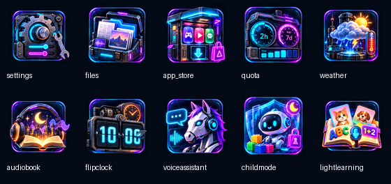

# 霓虹夜城 · 赛博朋克桌面 1.0.0

适用于480×480的ESP32-S3-Touch-AMOLED-2.16，固件s3.31。包含夜城壁纸和10个带有应用内容元素的插画图标。桌面继续使用原生横向分页，每页3列2行。

在“设置 → 显示 → 桌面主题”选择“经典Q版”或“赛博朋克”，壁纸、10个图标及桌面名称颜色一同切换，无需重启，选择保存在NVS。首次安装资源需要重启一次加载字体及图片。此开关改变桌面；应用内部界面保持各自设计。

| 图标 | 主题元素 |
| --- | --- |
| 设置 | 齿轮、调节滑块、扳手 |
| 文件 | 数据箱、文档、照片、音频卡 |
| 应用商店 | 应用售卖机、下载指示 |
| 额度显示 | 双周期时间仪表、日历条 |
| 天气 | 云、太阳、雨、闪电及温度计 |
| 听书 | 故事书、耳机、月亮及城堡 |
| 翻页时钟 | 翻页数字、转轴、机械钟 |
| 小马助手 | 机械马、麦克风耳机、对话框及声波 |
| 儿童模式 | 防护罩、玩具机器人、积木及锁 |
| 轻学习 | 动物卡片、ABC、口算及跟读麦克风 |




图标内仪表和时钟上的数字属于静态装饰，实际额度和时间在对应应用中显示。

## 安装及回退

先停止电脑端额度采集并保持USB连接，创建和校验完整设备备份，再用`update_brookesia_app_only.py`只更新s3.31应用分区，保留NVS、LittleFS、SD及用户数据。随后在仓库根目录执行：

```powershell
codex-quota-monitor/.venv/Scripts/python.exe codex-quota-monitor/tools/deploy_desktop_themes.py --port COM3
```

安装器将11个原生资源放到`/sdcard/themes/cyberpunk-v1/`，注册Shell图片和中文字库，并在设置中加入选择框。JSON通过有SHA256校验的分帧传输暂存到SD，复制到目标后读取核对；旧资源备份到SD的`/sdcard/resource-backups/desktop-theme-时间戳/`及电脑私有runtime目录。故事、书签、播放模式、音量及原壁纸文件保持。第一次安装后重新启动设备，选择赛博朋克。

日常回退只需在设置选择“经典Q版”。SD资源在启动时不完整会回退到原Q版缓存和壁纸，拒绝选择不可用主题；重新插卡后重启加载完整主题。原应用的图标索引保留，所以更新应用和返回桌面仍有原有的安全回退。移除此功能或降级s3.30时，应先恢复安装器保存的Shell和设置文档，再刷回已验证的旧应用分区。

## 构建与验证

`source/icons-atlas.png`和`source/wallpaper.png`是通过内置imagegen生成并保留的原稿，生成提示词说明见[source/PROMPTS.md](source/PROMPTS.md)。`tools/build_cyberpunk_theme.py`按`theme.json`记录的裁切框导出图标；图标为92×92、壁纸为486×486、不透明RGB565/RLE。构建器独立解码检查全部像素。图片在启动时预载到内存，拖动过程不读取SD或进行PNG缩放、透明混合。两套资源共存，切换不覆盖原Q版资源。

`tools/build_desktop_theme_font.py`从Noto Sans SC导出主题选择字库，已核对全部中文字形；来源哈希见`font-source.json`，遵守随附OFL许可。`package_desktop_theme.py`生成可分发资源包及SHA256记录。固件通过三个补丁依次构建，`tools/check_patch_chain.py`校验34个上游文件与实际构建源码一致。

实机已通过两轮“Q版 → 赛博朋克 → Q版 → 赛博朋克”切换、非法索引拒绝和重启记忆检查，正式资源加载成功，无重启。强制整屏重绘约119–129ms，与Q版接近；这是整屏重绘耗时，不能作为实际滑动帧率。原10篇故事、书签、听书模式和音量75已核对保留。2026-10-29用户在设置中来回切换并滑动桌面后确认：“两套主题切换正常，滑动也正常”。
